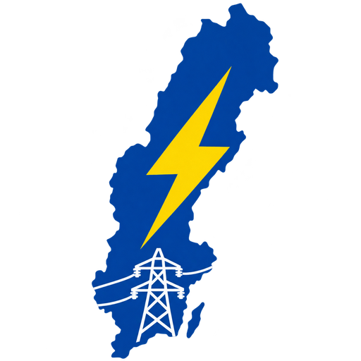

  

# Svenska kraftsystemet – Home Assistant

Unofficial Home Assistant integration for monitoring Sweden's electricity generation, consumption and physical cross-border electricity flows using the **ENTSO-E Transparency Platform**.

**Latest stable release: [v0.1.11](https://github.com/JojjeHA/svenska-kraftsystemet/releases/tag/v0.1.11).**

> **Disclaimer:** This independent, community-developed integration is not affiliated with or endorsed by Svenska kraftnät, ENTSO-E or Home Assistant. Reported data may be delayed, incomplete or revised. Do not use it for safety-critical or operational decisions.

## Features

- Reported generation by production type across SE1–SE4
- Nuclear, hydro, wind and other generation totals and reported shares (%)
- Electricity consumption by bidding zone and nationally
- Physical electricity imports, exports and net exports
- Automatic updates every 15 minutes
- Validation of incomplete generation datasets before calculating percentages
- Selective retries on transient API failures, including HTTP 599
- Up to 60 minutes of cached complete data during temporary disruptions, with cache-status sensor attributes
- Native Home Assistant sensors; optional dashboard example

## Quick installation (HACS)

1. In HACS, add `https://github.com/JojjeHA/svenska-kraftsystemet` as a custom **Integration** repository.
2. Download **Svenska kraftsystemet** and restart Home Assistant.
3. Go to **Settings → Devices & services → Add integration**.
4. Select **Svenska kraftsystemet** and enter your ENTSO-E API token.

Requires **Home Assistant 2026.11.0 or newer**, an internet connection and an ENTSO-E Transparency Platform API token. See the [full setup guide](docs/installation.md) for token instructions, manual installation and optional sensors.

## Documentation

- [Installation, API token and configuration](docs/installation.md)
- [Available sensors and calculations](docs/sensors.md)
- [Home Assistant dashboard YAML example](docs/dashboard.md)
- [Data sources, caching, quality checks and limitations](docs/data-and-limitations.md)
- [Version history](docs/changelog.md)

## Support

[Report a problem or request a feature](https://github.com/JojjeHA/svenska-kraftsystemet/issues). Include your Home Assistant version and integration version, but **never share your API token**.

Electricity data: [ENTSO-E Transparency Platform](https://transparency.entsoe.eu/). Released under the [MIT License](LICENSE).
